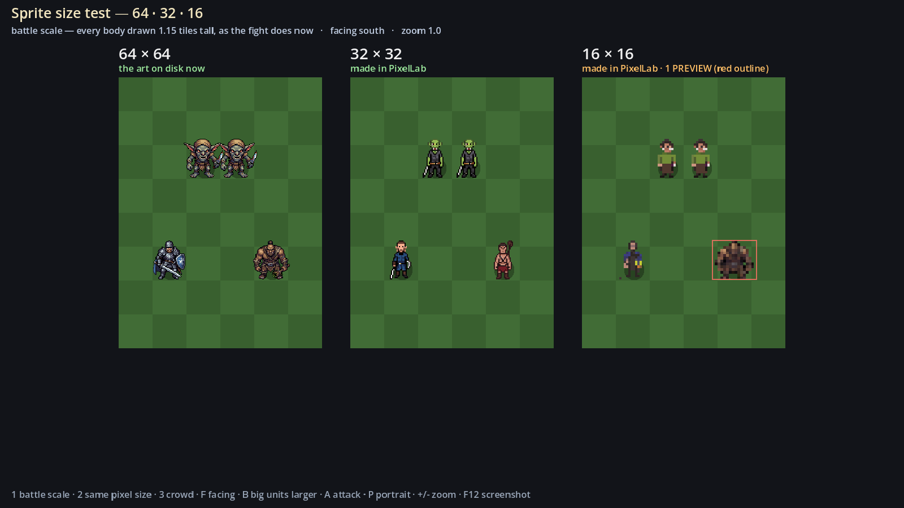
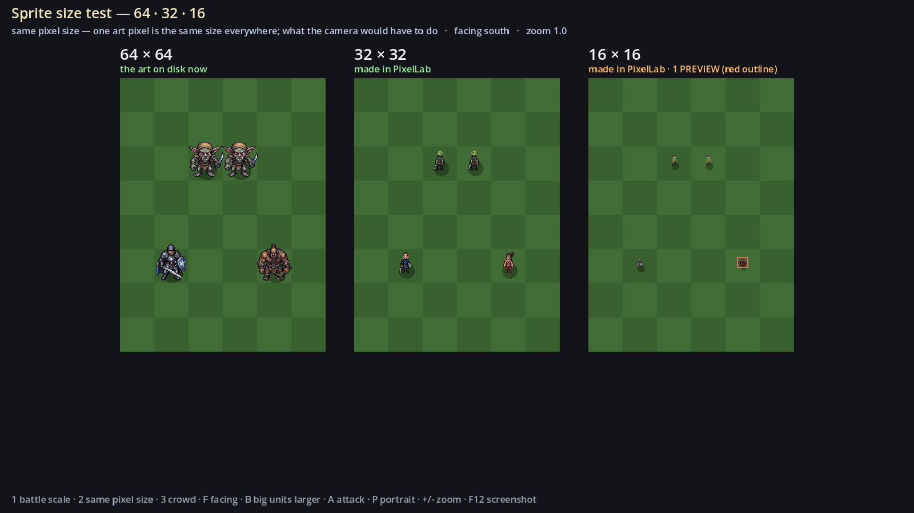
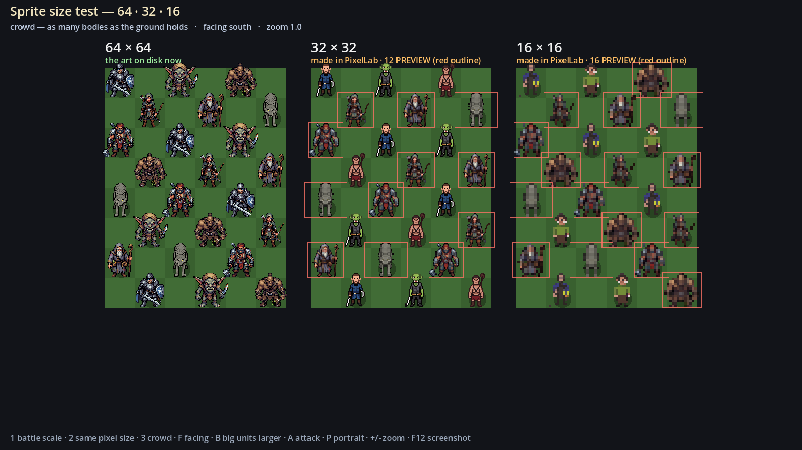
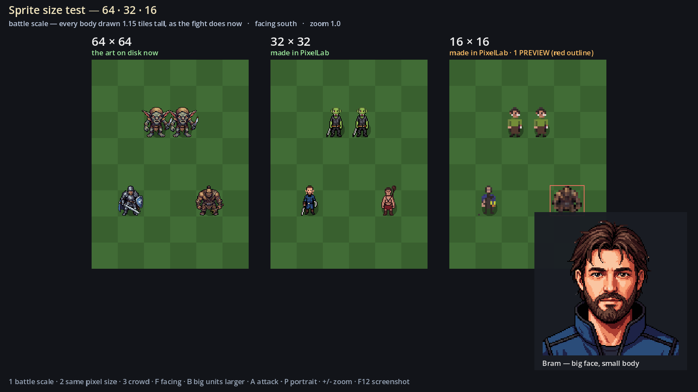
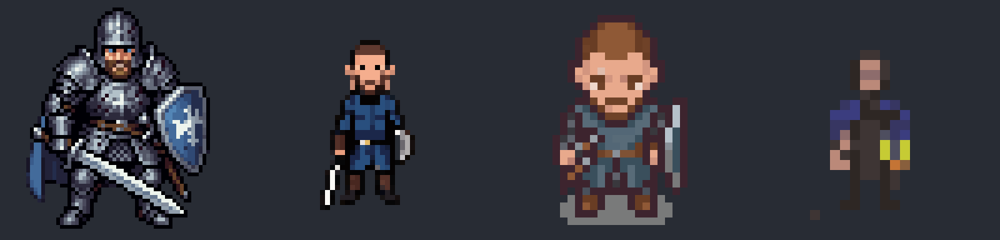
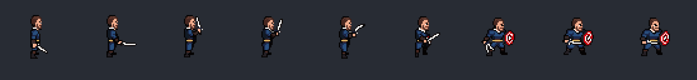
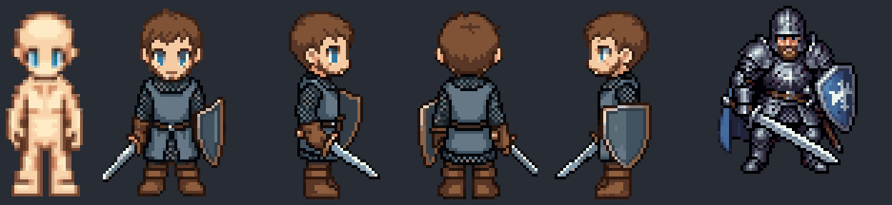
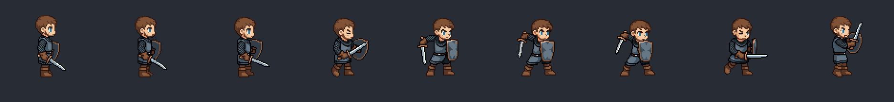
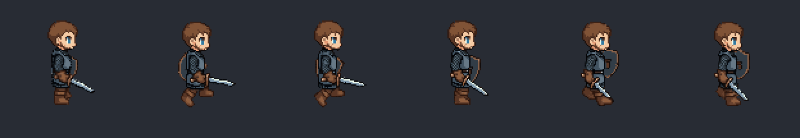

# Size test — results

Filled in as the test is done. Instructions: [docs/20](../../docs/20-pixellab-size-test.md).

## What it cost

Generated 2026-10-12 through the API (`tools/pixellab.py`), on the Tier 2 plan: 5,000
generations a month. The whole test cost **34 generations** (0.7 % of a month). Same prompt, view
(low top-down) and template (mannequin) as the 64s; "standard" mode unless the row says otherwise.

| # | Generated | Size | Directions | Frames | Generations | Notes |
| --- | --- | --- | --- | --- | --- | --- |
| 1 | `sworn_blade` | 32 | 8 | — | 1 | Comes back on a 48 × 48 canvas; the body is 19 × 34 |
| 2 | `goblin` | 32 | 8 | — | 1 | |
| 3 | `club_ogre` | 32 | 8 | — | 1 | A thin man with a club: the template is human-sized, so it is not hulking |
| 4 | `sworn_blade` | 16 | 8 | — | 1 | 24 × 24 canvas, body 10 × 17 |
| 5 | `goblin` | 16 | 8 | — | 1 | Reads as a person in a green shirt |
| 6 | `sworn_blade` attack, 32 | 32 | 4 (S E N W) | 9 a direction (8 asked + the start pose) | 4 | 1 a direction. Drifts: a round red shield appears halfway through |
| 7 | `sworn_blade` portrait | 128 | — | — | 15 | Made from the 32 body; 160 is not offered for this view |
| 8 | `sworn_blade` 32, **pro** mode | 32 | 8 | — | 10 | Extra, not in docs/20: closer to the prompt (mail, shield) but big-headed. Not in the viewer; see below |

**What that says about a month.** A body is 1 generation in standard mode, 10–25 in pro. An
animation is 1 a direction in standard (v3) mode, so the fighting set of six states on four facings
is about 24 a unit. Tier 1's eleven units would be roughly 11 bodies + 264 animation generations —
under 6 % of a month in standard mode.

**The 64s on disk are not what the API makes at 64.** They fill their 64 canvas (Bram is 49 × 59) and
look heroic and detailed. The API's standard mode at 32 makes a plainer, thinner figure on a bigger
canvas. Some of the difference between columns is the mode and the model, not only the size.

Bram: the 64 on disk, 32 standard, 32 pro, 16 standard, each drawn the same height:

The 32 attack, facing east, frame by frame:

The ogre at 16 was not generated (docs/20 says not to), so it is still a preview, outlined in red.

## The base body, 2026-10-12

The founders made a blank body in PixelLab on 2026-09-25, "Blank Male character". Dressing it as
Bram with one sentence (`python3 tools/pixellab.py dress sworn_blade`) kept his mail, surcoat,
beard, sword and kite shield in every facing, at about 65 pixels tall, for 10 generations. It is
in the viewer as the 64 Bram. Left to right: the base, dressed Bram in four facings, the 64 on disk.

Animated on the base: the overhead slash from words (8 generations, 9 frames, Bram stays Bram;
the shield swings to the front) and PixelLab's walk template in the steadier skeleton mode
(12 generations, 6 frames).

Running total for the day: 64 generations of 5,000.

## What we saw

| Question (viewer key) | 64 | 32 | 16 |
| --- | --- | --- | --- |
| Reads at battle scale (1) | | | |
| Crowd still reads (3) | | | |
| Facing reads (F) | | | |
| Big units larger? (B) | | | |
| Attack reads (A) | | | |

## The call

- dougie (Will): handed the call to Claude on 2026-10-12, with the blank body as the base.
- doug-md: \_\_ — because \_\_
- **Chosen: the 64 class, dressed onto the base body.** Written into docs/06 as D55 on 2026-10-12,
  **Inferred** until both founders confirm.
