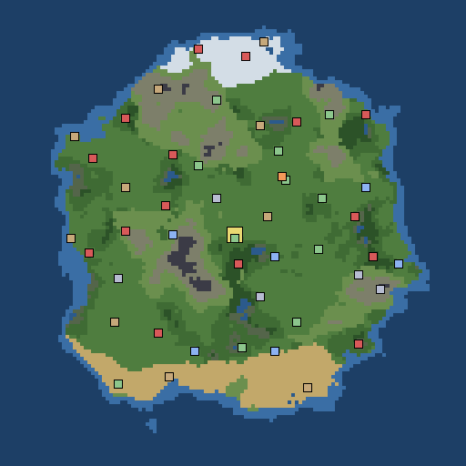

# 27 — The world

**Every run is played on one world** ([D91](06-decisions.md), [D92](06-decisions.md)): the same
land and the same places every game, improved by hand as the game grows. `doug-md` chose it on
2026-10-12: Map F of six the generator made, with the Tower moved to the middle. It was built on
2026-10-14, frozen again from today's generator: tile for tile the same land, and every place where
his was.

Yellow is the Tower, grey-blue keeps, green villages, blue libraries, red gates, tan huts, orange
home. 128 by 128 tiles: snow along the north, sand along the south coast, ocean all round. The
great city, Stormreach, stands at the Tower's foot, on the tile south of it, and the open rank E gate
Greyhollow 8 tiles south of that, open in every world (`first_gate`): the First Hour's road
([D85](06-decisions.md), [D101](06-decisions.md)). A second open rank E gate, Elderford, stands 9 tiles
north of the city (`second_gate`), so the Guild offers two ([D147](06-decisions.md)). In the first world the lead comes down 12 to 16
tiles from Stormreach.

## What is the same every run, and what is not

| Always the same | Dealt by the run's seed |
| --- | --- |
| The land, tile by tile | Where the lead crash-lands, and so where home is |
| Which land each tile is (snow, dune, swamp and the rest, [D66](06-decisions.md)), and the ground inside it | Where the others of the sixteen land and walk |
| Every place: where it is, its name, its inside (`area`), its owner, a gate's rank and ward, a library's books | Monsters, bands, encounters, roadside scenes, rumours, people's names |
| The Tower, in the middle | Which gates are spilling as the run starts, in a world after the first ([M15](05-roadmap.md)) |

The lands and the ground come from the map's own seed (`from_seed`, kept on the world as
`land_seed`), not the run's. The seed box on the New Game screens says what the seed decides.
**Inferred:** which side of the line each thing falls on is Claude's reading of D91, agenda item 76.

## Changing it

The world is `data/world_map.json`. A run copies it and never writes back.

- **`tiles`** — 128 rows of 128 symbols, top row first: `.` grass, `,` brush, `^` hill, `A` crag,
  `#` impassable wall (mountain), `~` shallow water, `l` lake, `o` ocean, `s` sand, `w` snow,
  `f` forest, `b` marsh, `=` road. The list is `World.LEGEND` in `src/chronicle/world.gd`.
- **`sites`** — every place: `kind`, `cell` ([x, y], from the top-left), `display_name`, and for a
  gate `rank` (E to S) and `open`, plus `data` (`area`: which inside from `data/areas`; `city`;
  `faction`: who holds it; `ward`; a library's `doctrine`; `first_gate`, a gate kept open in every world). Places keep at least
  nine tiles apart, except the First Hour's city and gate ([D101](06-decisions.md)).
- **`from_seed`** — the seed the lands and the ground are drawn from. Changing it changes every
  land on the map.
- **See it:** `godot --headless --path . res://tools/world_maps.tscn -- --fixed` draws it into
  `docs/images/world/the-world.png`. Redraw it in the same commit as a change to the map.
- **Tested:** `tests/world_smoke_test.gd` (`one_world`) checks two seeds get the same map and the
  same lands, the Tower is in the middle, and a run cannot write back into it.

`tools/bake_world.tscn` is how the file was made, from the generator. Running it again would throw
away every hand edit, so it refuses unless given `-- --force`. The generator itself
(`WorldGen.generate_random`) is kept for that tool and for worlds of another size;
`tools/world_maps.tscn -- --seeds=11,77` draws what it makes from other seeds.

The wild places on the map (D309) are written by `python3 tools/place_wilds.py` (`--dry` to see where
they would go): twelve sites of kind `wild`, then two cloud peaks (D321) and six hamlets (D330,
`data/areas/hamlet_*.json`), each on its own kind of ground, and two caravans (D331) outside towns, which
then walk a round of four, dealt from `from_seed`.
Run it again after changing the tiles or moving a place; it leaves every other site alone. Each wild
tells a story in three pages stood on, and its end goes in the annals (D314, `story` and `page` spots in
`data/areas/wild_*.json`).
